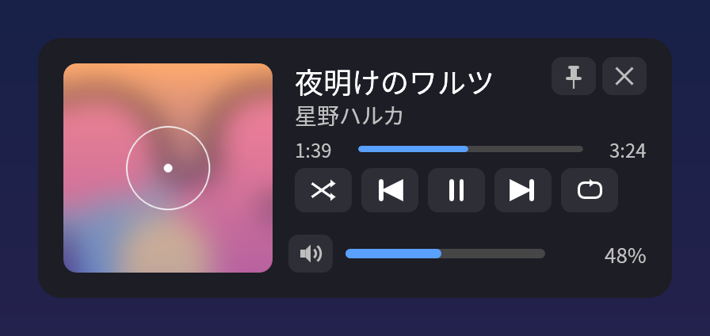
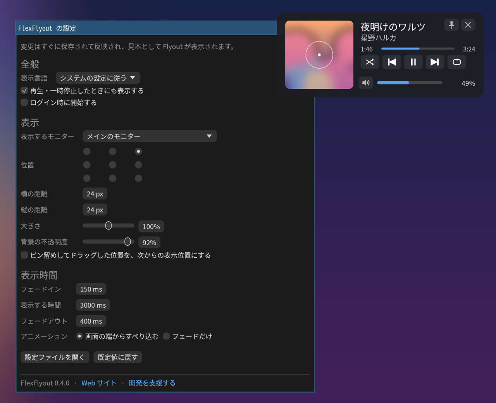

# FlexFlyout


[](https://github.com/akivajp/flexflyout/actions/workflows/ci.yml) [](https://github.com/akivajp/flexflyout/releases/latest)

[English](README.md)

> **開発の初期段階です。** Windows 11 と KDE Plasma（Wayland）で動きます。GNOME はこの後に対応します。

柔軟に調整できる、クロスプラットフォームのメディアの Flyout です。音量を変えたときや新しい曲が始まったときに、再生中の曲の情報（ジャケット・曲名・アーティスト）を、再生位置、再生の操作ボタン（シャッフル・リピートを含む）、音量と一緒に表示し、しばらくすると消えます。バーをクリック・ドラッグすると再生位置や音量を変えられます。ピン留めすると表示したままになり、好きな位置へドラッグで動かせます（その位置を次からの表示位置にすることもできます）。すぐに閉じるボタンもあります。

<p align="center"></p>

画面の大きさやモニターの構成は人によって違うので、表示のすべてを調整できるようにします。

- **大きさ**: 表示全体の拡大率
- **位置**: 9か所の基準点と、ピクセル単位のずらし幅
- **表示先のモニター**: メインのモニター、カーソルのある画面、番号で指定した画面
- **表示時間**と**不透明度**
- **OS 標準の音量表示**（Windows・KDE Plasma）: 残して、重ならないように表示するか、消すか

<p align="center"></p>

<sub>スクリーンショットは Linux で見本の曲を流して撮ったものです。Windows 11 でも Flyout の見た目は同じです。</sub>

## 対応する環境

| 環境 | 状況 |
|---|---|
| Windows 11 | 公開中（x86_64） |
| Linux — KDE Plasma（Wayland） | 公開中（x86_64）。sway・Hyprland など、layer-shell に対応するほかの環境でも動く |
| Linux — GNOME（Wayland） | 予定。FlexFlyout から送った内容を描くだけの、小さな GNOME Shell 拡張として作る |
| macOS | 将来 |

## インストール（Windows 11）

[Scoop](https://scoop.sh) で [akivajp のバケット](https://github.com/akivajp/scoop-bucket) から入れると、スタートメニューにも追加されます（`scoop update flexflyout` で更新できます。先にタスクトレイのアイコンから FlexFlyout を終了してください）。

```powershell
scoop bucket add akivajp https://github.com/akivajp/scoop-bucket
scoop install akivajp/flexflyout
```

以前に定義ファイルの URL から入れた場合は、更新が届くように、バケットの README の手順でバケットに切り替えてください。

または、[Releases](https://github.com/akivajp/flexflyout/releases) のページから `flexflyout-<版>-x86_64-pc-windows-msvc.zip` を取り、好きな場所に展開して `flexflyout.exe` を起動します（チェックサムは `SHA256SUMS`）。まだコード署名をしていないため、初回に Windows SmartScreen の警告が出ることがあります。**詳細情報** → **実行** を選んでください。

FlexFlyout は通知領域（タスクトレイ）で動きます。メニューから、Flyout の表示・設定ウィンドウ・**Windows の起動時に開始**の切り替え・終了ができます。設定は `%APPDATA%\flexflyout\config.toml` に保存され、手で書き換えることもできます（保存して1秒以内に反映）。`flexflyout --help` でコマンドラインのオプションを、`flexflyout --demo` で見本の曲を表示できます。

### アンインストール

1. タスクトレイのメニューで **Windows の起動時に開始** を外し、FlexFlyout を終了します（Scoop の場合は自動で外れます）。
2. `scoop uninstall flexflyout` を実行するか、zip を展開したフォルダーを消します。
3. 必要なら、設定とログも消します: `%APPDATA%\flexflyout` と `%LOCALAPPDATA%\flexflyout`。

Windows 標準の音量表示を消す設定にしていた場合も、FlexFlyout を終了すれば元に戻ります。

## インストール（Linux）

layer-shell に対応した Wayland のデスクトップで動きます。KDE Plasma・sway・Hyprland など wlroots 系が対象で、GNOME と X11 では動きません。MPRIS に対応したプレーヤー（Spotify・ブラウザー・VLC・mpv-mpris を入れた mpv・Elisa など）と、PipeWire または PulseAudio の音量に合わせて表示します。音量キーは、キーで音量が変わることで表示のきっかけになります。

Arch Linux とその派生（CachyOS・EndeavourOS・Manjaro）では、[`packaging/aur/flexflyout-bin/PKGBUILD`](packaging/aur/flexflyout-bin/PKGBUILD) でリリースのバイナリーをメニュー項目付きで入れられます。

```sh
git clone https://github.com/akivajp/flexflyout.git
cd flexflyout/packaging/aur/flexflyout-bin && makepkg -si
```

ほかのディストリビューション（glibc 2.35 以降）では、[Releases](https://github.com/akivajp/flexflyout/releases) のページから `flexflyout-<版>-x86_64-unknown-linux-gnu.tar.gz` を取り、`flexflyout` を `PATH` の通った場所に置きます。メニュー項目が要る場合は、`flexflyout.desktop` を `~/.local/share/applications` に、`flexflyout.png` を `~/.local/share/icons/hicolor/256x256/apps` に置いてください。

メニューか `flexflyout` で起動します。タスクトレイのアイコン（KDE Plasma）のメニューは Windows と同じで、自動起動は **ログイン時に開始** です。設定は `~/.config/flexflyout/config.toml`、ログは `~/.local/state/flexflyout/` にあります。Windows と同じく、KDE Plasma 自身の音量表示と重ならないように表示するか、動いている間だけ消すかを選べます（消えるのは音量の表示だけで、明るさなどの表示は残ります）。

消すときは、**ログイン時に開始** を外し（または `~/.config/autostart/flexflyout.desktop` を消し）、パッケージを外す（`sudo pacman -R flexflyout-bin`）かファイルを消します。必要なら `~/.config/flexflyout` と `~/.local/state/flexflyout` も消してください。

## 仕組み

- **再生中の曲の情報と操作**: Windows は System Media Transport Controls（SMTC）、Linux は MPRIS
- **音量**: Windows は Core Audio、Linux は PipeWire / PulseAudio
- **画面**: Rust と [egui](https://github.com/emilk/egui)
- **表示言語**: まず英語と日本語。ほかの言語も足しやすい、翻訳の仕組みの上に作る

## 作る理由

Windows 10 では、音量の表示に、再生中の曲と再生の操作ボタンも出ていました。Windows 11 では、この部分が無くなりました。代わりになる他社のソフトは、最近の Windows 11 で動かなくなったか、大きさや位置をほとんど調整できず、Linux のデスクトップで動くものもありません。FlexFlyout は、この2つの穴を埋めることを目指します。

## コード署名の方針

Windows 版のリリースは、[SignPath Foundation](https://signpath.org) によるコード署名を予定しています。それまでのリリースには署名がありません。承認後は、[SignPath.io](https://about.signpath.io) による無償のコード署名、[SignPath Foundation](https://signpath.org) の証明書を使います。

- **署名するもの**: Windows 版のリリースの zip に入っている `flexflyout.exe`。このリポジトリのタグのソースから GitHub Actions（[`release.yml`](.github/workflows/release.yml)）でビルドしたものだけです。ほかの場所でビルドしたものには署名せず、署名の依頼は毎回、人が承認します。
- **体制**: [Akiva Miura（@akivajp）](https://github.com/akivajp) が作者・レビュー担当・承認者です。ほかの人からの変更はプルリクエストで受け、レビューしてから取り込みます。

### プライバシー

FlexFlyout は利用状況を送信しません。メディアプレーヤーがシステムに知らせる情報（曲、ジャケット、再生位置）と音量を読み、Windows では Flyout を出すきっかけとして音量キーとメディアキーを見るだけです（ほかのキーは記録も保存もしません）。設定とログは手元の PC にだけ置かれます。

ネットワークへの接続は1つだけです。Linux で、プレーヤーがジャケットを Web のアドレスで渡した場合（Spotify など）、そのアドレスから画像を取得します。Windows ではネットワークに一切接続しません。

## ライセンス

次のどちらかを選んで使えます。

- Apache License, Version 2.0（[LICENSE-APACHE](LICENSE-APACHE)）
- MIT ライセンス（[LICENSE-MIT](LICENSE-MIT)）
