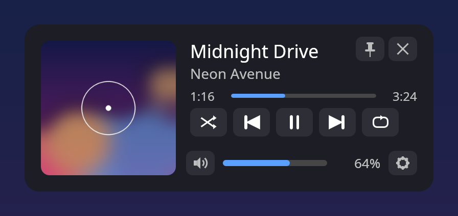
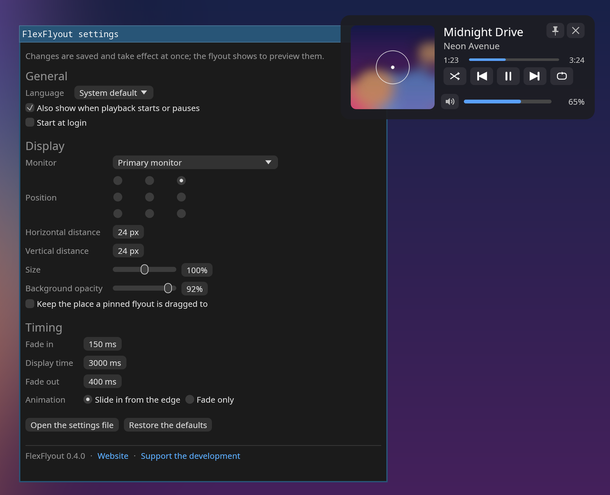

# FlexFlyout


[](https://github.com/akivajp/flexflyout/actions/workflows/ci.yml) [](https://github.com/akivajp/flexflyout/releases/latest)

[日本語](README.ja.md)

> **Early development.** Windows 11 and KDE Plasma (Wayland) work; GNOME follows.

A flexible, cross-platform media flyout. When you change the volume or a new track starts, it pops up with what is playing — cover art, title and artist — along with the position in the track, playback controls (including shuffle and repeat) and the volume, then fades away. Click or drag the bars to seek or set the volume. Pin the flyout to keep it on screen — and drag it wherever you like, optionally as its new usual place — or close it at once.

<p align="center"></p>

Screen sizes and monitor setups differ from desk to desk, so every part of the flyout is meant to be adjustable:

- **Size** — scale the whole flyout
- **Position** — nine anchor points plus pixel offsets
- **Monitor** — the primary one, the one under the cursor, or a specific one
- **Display time** and **opacity**
- **Look** — dark or light colors, the accent color, the roundness of the corners, and which parts to show (cover art, position bar, shuffle and repeat, volume) for a smaller flyout
- **The system's own volume indicator** (Windows, KDE Plasma) — keep it and place the flyout clear of it, or hide it

<p align="center"></p>

<sub>Screenshots taken on Linux with a sample track; the flyout looks the same on Windows 11.</sub>

## Platforms

| Platform | Status |
|---|---|
| Windows 11 | Available (x86_64) |
| Linux — KDE Plasma (Wayland) | Available (x86_64); also sway, Hyprland and other compositors with layer-shell |
| Linux — GNOME (Wayland) | Planned, as a small GNOME Shell extension that draws what FlexFlyout sends |
| macOS | Future |

## Installation (Windows 11)

With [Scoop](https://scoop.sh), from the [akivajp bucket](https://github.com/akivajp/scoop-bucket), which also adds FlexFlyout to the Start menu (`scoop update flexflyout` updates it; quit FlexFlyout from its tray icon first):

```powershell
scoop bucket add akivajp https://github.com/akivajp/scoop-bucket
scoop install akivajp/flexflyout
```

If you installed it from the manifest URL before, switch to the bucket as its README explains, so that updates keep coming.

Or download `flexflyout-<version>-x86_64-pc-windows-msvc.zip` from the [Releases](https://github.com/akivajp/flexflyout/releases) page, extract it anywhere and run `flexflyout.exe` (`SHA256SUMS` lists the checksum). The release is not code-signed yet, so Windows SmartScreen may warn the first time: choose **More info** → **Run anyway**.

FlexFlyout runs in the notification area (the tray). Its menu shows the flyout, opens the settings window, turns **Start with Windows** on or off, and quits. Starting FlexFlyout again while it runs opens the settings window. The settings are saved in `%APPDATA%\flexflyout\config.toml`, which can also be edited by hand (it is applied within a second of saving). `flexflyout --help` lists the command-line options; `flexflyout --demo` shows sample tracks.

### Uninstall

1. Turn **Start with Windows** off in the tray menu and quit FlexFlyout (Scoop turns it off for you).
2. Remove it: `scoop uninstall flexflyout`, or delete the folder you extracted the zip to.
3. Delete the settings and the log, if you like: `%APPDATA%\flexflyout` and `%LOCALAPPDATA%\flexflyout`.

If you hid the Windows volume indicator, it comes back when FlexFlyout quits.

## Installation (Linux)

FlexFlyout runs on Wayland desktops whose compositor offers layer-shell — KDE Plasma, sway, Hyprland and other wlroots ones (not GNOME, and not X11). It follows any player with MPRIS (Spotify, browsers, VLC, mpv with mpv-mpris, Elisa…) and the volume through PipeWire or PulseAudio. The volume keys show it through the volume change they cause; on KDE Plasma, where they are Plasma's shortcuts, the volume and media keys show it themselves, also at 0% and 100%.

On Arch Linux and derivatives (CachyOS, EndeavourOS, Manjaro), [`packaging/aur/flexflyout-bin/PKGBUILD`](packaging/aur/flexflyout-bin/PKGBUILD) installs the release binary with a menu entry:

```sh
git clone https://github.com/akivajp/flexflyout.git
cd flexflyout/packaging/aur/flexflyout-bin && makepkg -si
```

Elsewhere (glibc 2.35 or newer), download `flexflyout-<version>-x86_64-unknown-linux-gnu.tar.gz` from the [Releases](https://github.com/akivajp/flexflyout/releases) page and put `flexflyout` on your `PATH`; `flexflyout.desktop` and `flexflyout.png` go to `~/.local/share/applications` and `~/.local/share/icons/hicolor/256x256/apps` for a menu entry.

Start it from the menu or with `flexflyout`; starting it again while it runs opens the settings window. The tray icon (on KDE Plasma) has the same menu as on Windows, with **Start at login** instead. The settings are in `~/.config/flexflyout/config.toml` and the log in `~/.local/state/flexflyout/`. As on Windows, FlexFlyout stays clear of KDE Plasma's own volume popup, or hides it (the volume popup only; Plasma's brightness and other popups stay) while it runs.

To remove it: turn **Start at login** off (or delete `~/.config/autostart/flexflyout.desktop`), uninstall the package (`sudo pacman -R flexflyout-bin`) or delete the files, and delete `~/.config/flexflyout` and `~/.local/state/flexflyout` if you like.

## How it works

- **Now playing and playback controls**: the System Media Transport Controls (SMTC) on Windows, MPRIS on Linux
- **Volume**: Core Audio on Windows, PipeWire / PulseAudio on Linux
- **UI**: Rust and [egui](https://github.com/emilk/egui), with the system's fonts: titles in any script it has fonts for (Korean, Chinese, Thai…) show in them
- **Languages**: English and Japanese first, on top of a translation mechanism that makes adding more languages easy

## Background

On Windows 10, the volume flyout also showed the current track with playback controls. Windows 11 dropped that part. The third-party replacements either stopped working on recent Windows 11 builds or give little control over size and placement, and none of them run on Linux desktops. FlexFlyout aims to fill both gaps.

## Code signing policy

Code signing of the Windows releases through the [SignPath Foundation](https://signpath.org) is planned; until it is in place, releases are unsigned. Once approved: free code signing provided by [SignPath.io](https://about.signpath.io), certificate by [SignPath Foundation](https://signpath.org).

- **What is signed**: `flexflyout.exe` in the Windows release zip, built by GitHub Actions ([`release.yml`](.github/workflows/release.yml)) from the tagged source of this repository. Nothing built elsewhere is signed, and every signing request is approved by hand.
- **Team**: [Akiva Miura (@akivajp)](https://github.com/akivajp) is the author, reviewer and approver. Changes from others come as pull requests and are reviewed before they are merged.

### Privacy

FlexFlyout collects no telemetry. It reads what the media players report to the system (the track, its cover art and position) and the volume, and watches the volume and media keys only to know when to show the flyout — on Windows through a keyboard hook, on KDE Plasma through the announcements of those two kinds of Plasma's shortcuts (no other key is recorded or kept). Its settings and its log stay on your machine.

Network access:

- **The update check**: once a day, FlexFlyout asks GitHub (`api.github.com`) for the latest release, and says so in the tray menu and with a notification when a newer one is out. Nothing is downloaded or installed, and nothing about you is sent besides what any web request shows (your IP address and the app's version). Turn it off with `check_updates = false`, or "Check for new versions" in the settings window.
- **Cover art** (Linux): when a player gives its cover art as a web address (Spotify does), FlexFlyout downloads that image from that address.

## License

Licensed under either of

- Apache License, Version 2.0 ([LICENSE-APACHE](LICENSE-APACHE))
- MIT license ([LICENSE-MIT](LICENSE-MIT))

at your option.
